  

  

Estudo Engenharia de Software na UNICID e tenho uma empresa de tecnologia em São Paulo. No dia a dia eu faço duas coisas que parecem diferentes mas acabam se encontrando: sites para clientes e sistemas internos para empresas, quase sempre resolvendo algum processo que hoje vive em planilha, e-mail ou papel.

Na web eu gosto de HTML, CSS e JavaScript puros, sem framework quando dá, e uso Supabase quando o projeto precisa de banco e login. Nas empresas trabalho com Power Apps, Power Automate, Power BI e SharePoint, montando apps de aprovação, apontamento e relatório.

 

<h3>▸ PROJETO EM DESTAQUE</h3>

  <a href="https://assembleia-de-deus-pq-artur-alvim.vercel.app"><b>Ver o site</b></a> &nbsp;·&nbsp;
  <a href="https://github.com/fellipeaguiardev/assembleia-de-deus-pq-artur-alvim"><b>Ver o código</b></a>

  

 

<h3>▸ TRABALHOS DA FACULDADE</h3>

  

<h3>▸ O QUE EU USO</h3>

  

Boa parte do que faço para clientes e empresas fica em repositórios privados ou dentro do Microsoft 365, então nem tudo aparece por aqui.

  

